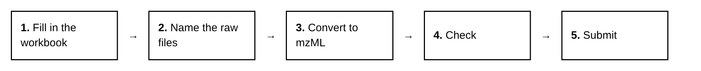
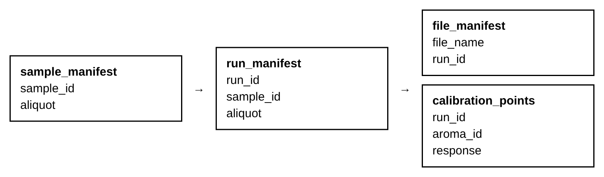
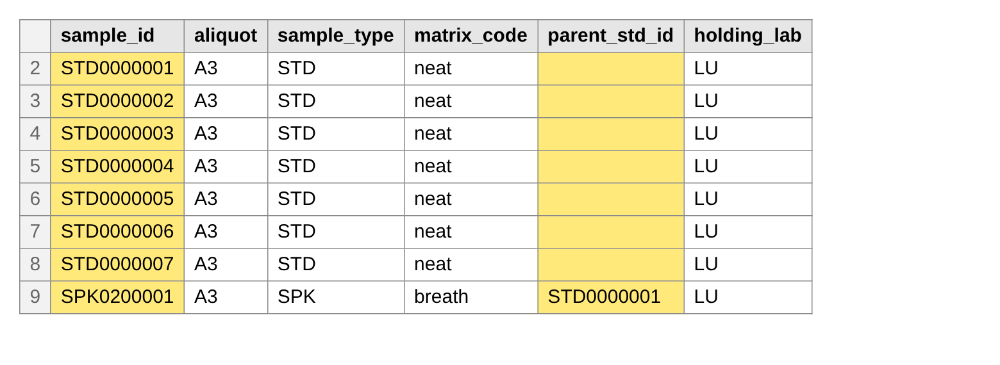
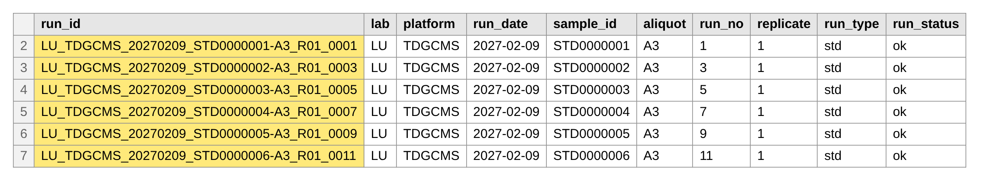
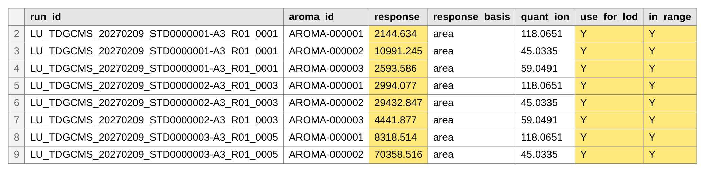
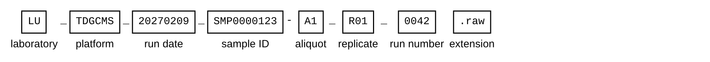
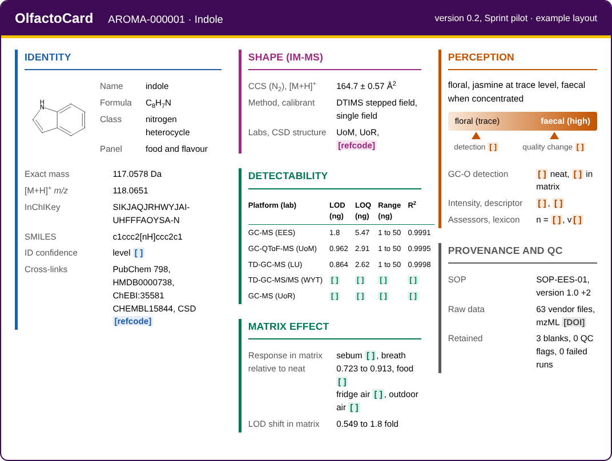

# AROMA data submission

Version 0.2. Applies to UoM, EES, LU, UoR and WYT.

## Materials

- [Blank workbook](https://github.com/trivedi-group/aroma-submission-guidance/raw/main/templates/Submission%20template%20v1.xlsx)
- [Filled example workbook](https://github.com/trivedi-group/aroma-submission-guidance/raw/main/templates/Example%20filled%20workbook%20v1.xlsx). All values are synthetic.
- [Blank CSV sheets](templates) and the [example as CSV](example/LU)
- [Checker](checker) with instructions

## Procedure

Complete steps 1 to 5 for every batch (Figure 1).

Figure 1. Workflow for each batch.

### Step 1. Fill in the workbook

1. Open the blank workbook. Use the filled example as a guide.
2. Enter one row in sample_manifest for each tube analysed.
3. Enter one row in run_manifest for each injection.
4. Enter one row in file_manifest for each file.
5. Enter one row in calibration_points for each compound in each run.
6. Select codes from the drop-down lists. Cells with a list accept only allowed codes.

Figure 2. Links between sheets. Each sheet points to the one before it by identifier.

Figure 3. sample_manifest. The sample_id identifies the tube. A spiked sample (SPK) names its source standard in parent_std_id.

Figure 4. run_manifest. The run_id equals the raw file name without its extension.

Figure 5. calibration_points. The response is the value from the laboratory's own software. use_for_lod marks the low points used for the detection limit. in_range marks the points inside the linear range.

### Step 2. Name the raw files

1. Name each file as shown in Figure 6.
2. Zip each vendor folder into one file with the same name stem.

Figure 6. Raw file name. Example: LU_TDGCMS_20270209_SMP0000123-A1_R01_0042.raw

Table 1. Sample ID prefixes.

| Prefix | Sample type | Issued by | Example |
|---|---|---|---|
| STD | Standard | UoM | STD0000003 |
| SPK | Spiked sample | Laboratory, own block | SPK0200003 |
| BLK | Blank | Laboratory, own block | BLK0200001 |
| QCP | Pooled QC | Laboratory, own block | QCP0200001 |
| SMP | Real sample | Laboratory, own block | SMP0200001 |

Table 2. Blocks for SPK, BLK, QCP and SMP numbers.

| Laboratory | First | Last |
|---|---|---|
| UoM | 1 | 100000 |
| EES | 100001 | 200000 |
| LU | 200001 | 300000 |
| UoR | 300001 | 400000 |
| WYT | 400001 | 500000 |

### Step 3. Convert to mzML

1. Convert a copy of each raw file to mzML with ProteoWizard msconvert.
2. Enter the converter and its version in file_manifest.

### Step 4. Check

1. Run the [checker](checker) on the filled workbook.
2. Correct every error and run the checker again until the last line is PASS.

### Step 5. Submit

1. Submit the filled workbook, the raw files with their SHA-256 checksums, and the mzML files.
2. Upload location and method. To be confirmed by UoM.

### Output

AROMA loads all submissions into one database, derives the detection limits and other values in the same way for every laboratory, and updates the OlfactoCards.

Figure 7. OlfactoCard built from the synthetic demonstration data.

## Rules

### Identifiers

1. Use AROMA-NNNNNN for compounds, with 6 to 8 digits. The registry issues them. Laboratories never create them.
2. Use STD followed by 7 digits for standards. UoM issues all of them.
3. Use SPK, BLK, QCP and SMP followed by 7 digits for spiked samples, blanks, pooled QC and real samples. Issue them from the laboratory's own block (Table 2).
4. Record the source standard of every spiked sample in parent_std_id.
5. Use A followed by 1 or 2 digits for the aliquot, for example A1. Give each laboratory its own aliquot number for a tube.
6. Write codes in capital letters and digits. Do not use underscores in codes.

### Raw file names

Use the pattern LAB_PLATFORM_YYYYMMDD_SAMPLEID-ALIQUOT_Rnn_RUNNO.ext (Figure 6).

1. Do not repeat the sample type. The sample ID prefix gives it.
2. Write the replicate as Rnn and the run number with 4 digits. The run number is unique within the laboratory and day.
3. Zip each vendor folder (.d or .raw directory) into one file with the same name stem.
4. Do not use spaces.
5. Save a corrected file as a new file with a new run number. Do not overwrite or rename a submitted file.
6. Keep each batch in a folder named YYYYMMDD_Bnn.
7. Make the run_id in the run_manifest sheet equal to the file name without its extension.

### Formats

1. Raw data. Keep the vendor file unaltered, zipped per run.
2. Open copy. Convert to mzML with ProteoWizard msconvert. Record the converter and its version in the file_manifest sheet. Convert one file and report whether the ion mobility dimension is kept before the first batch.
3. Tables. Use the workbook. For tables over about 50,000 rows use UTF-8 CSV with the same headers.
4. Write dates as YYYY-MM-DD. Write date and time as ISO 8601 with a UTC offset, typed as text.
5. Use a decimal point.
6. Do not enter human-linked metadata or session-level perception data. They stay in the controlled tier.

### Compound responses

Each laboratory processes its own raw data and reports one response per run and compound.

1. Record processing_software and processing_version for every run.
2. Record quant_ion for every response.
3. Set use_for_lod and in_range from the laboratory SOP.
4. List untargeted features in the features sheet. Keep unassigned features.
5. Keep the raw and mzML files with their checksums. AROMA may reprocess them centrally.

### Checks

The checker tests every column, the links between sheets, the agreement between file names and the run_manifest, that an amount can be derived for every response, and that each sample ID lies in an allocated block. Correct every error before submitting.

### Retained records

Keep blanks, failed runs and runs excluded after QC. Mark them with run_status and a note. AROMA retains and counts them on the card.

## Workbook sheets

One sheet per table. * marks a required column. Complete an optional sheet only when the data exist. Allowed codes are in the Vocabularies sheet and in the tables below.

### sample_manifest

One row per aliquot analysed by the laboratory. The mandatory collection fields are required for every sample type except standards.

Columns: sample_id*, aliquot*, sample_type*, matrix_code*, parent_std_id, holding_lab*, collection_datetime*, collection_device*, sorbent*, volume_ml*, flow_ml_min*, temperature_c*, rel_humidity_pct*, storage_duration_h*, transport_conditions*

### sample_attributes (optional)

Stream-specific fields in long format, so a new matrix needs a new vocabulary entry and not a new column.

Columns: sample_id*, aliquot*, attribute*, value*

### run_manifest

One row per acquisition. The run_id is the file name without its extension and encodes lab, platform, date, sample, aliquot and run number.

Columns: run_id*, lab*, platform*, run_date*, sample_id*, aliquot*, run_no*, replicate*, batch_id*, run_type*, run_status*, status_note, injection_datetime*, instrument_id*, method_id*, sop_id*, sop_version*, delivered_volume_ul, processing_software*, processing_version*, internal_standard

### file_manifest

One row per file, raw or exported. Raw vendor folders are archived as a single zip so that one checksum covers them.

Columns: file_name*, run_id, kind*, sha256*, size_bytes*, uri, converter_version

### calibration_points (optional)

One response per run and compound. The amount is never typed by the laboratory. It is derived from the standard registry and the delivered volume in the run manifest.

Columns: run_id*, aroma_id*, response*, response_basis*, quant_ion*, use_for_lod*, in_range*

### features (optional)

Harmonised feature table, one row per run and feature. Unassigned features are kept, with a blank aroma_id.

Columns: run_id*, feature_id*, aroma_id, rt_min, mz*, adduct, area, area_is_ratio, id_level, snr, flags

### ccs_results (optional)

One row per laboratory, platform, compound, adduct, buffer gas and method. The expanded uncertainty states its coverage factor.

Columns: lab*, platform*, aroma_id*, adduct*, buffer_gas*, method*, calibrant*, ccs_a2*, expanded_uncertainty_a2*, coverage_factor*, n_replicates*, confidence*

## Allowed codes

### Laboratories

| code | name |
|---|---|
| UOM | University of Manchester, Chemistry |
| EES | University of Manchester, Earth and Environmental Sciences |
| LU | Loughborough University |
| UOR | University of Reading |
| WYT | University of Manchester breath laboratory at Wythenshawe Hospital |

### Platforms

| code | name |
|---|---|
| GCQTOF | Gas chromatography quadrupole time-of-flight mass spectrometry |
| TDQQQ | Thermal desorption GC triple quadrupole mass spectrometry |
| TDGCMS | Thermal desorption gas chromatography mass spectrometry |
| GCMS | Gas chromatography mass spectrometry |
| TDGCO | Thermal desorption GC with olfactometry port |
| IMMS | Ion mobility mass spectrometry |
| DESI | Desorption electrospray ionisation mass spectrometry |
| CITOF | Chemical ionisation time-of-flight mass spectrometry |
| PTRMS | Proton transfer reaction mass spectrometry |

### Matrices

| code | display |
|---|---|
| neat | neat |
| sebum | sebum |
| breath | breath |
| food | food |
| fridge_air | fridge air |
| outdoor_air | outdoor air |
| test_house_air | test house air |

### Run types

| code |
|---|
| std |
| blank |
| qc |
| sample |
| spiked |

### Run status

| code |
|---|
| ok |
| failed |
| excluded |

### File kinds

| kind | extension |
|---|---|
| raw_vendor | raw |
| raw_vendor | d.zip |
| raw_vendor | raw.zip |
| raw_vendor | wiff |
| raw_vendor | wiff.zip |
| raw_vendor | qgd |
| raw_vendor | lcd |
| mzml | mzML |
| mzml | mzML.gz |
| feature_table | csv |
| feature_table | parquet |
| log | txt |
| other | zip |

## Further information

[Data dictionary](DATA_DICTIONARY.md) lists every column with its type and rules.
